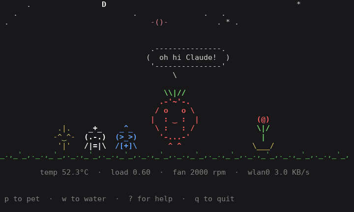

# Pi Pet

A little raspberry that lives in the terminal and reacts to the Raspberry Pi's real vitals.

<p align="center">
  
</p>

<sub>Recorded from real runs on the Pi (`--mood` forces each mood for the demo).</sub>

## Moods

The pet checks the Pi every 2 seconds and picks the first mood that fits:

| Mood | When | What it does |
|---|---|---|
| Dizzy | The kernel's undervoltage alarm is on (the power supply can't keep up) | `@ @` eyes, stars circling its head |
| Hot | CPU at 70 °C or more | `> <` face, sweat drops |
| Stuffed | SD card 90% full or more | Puffed-up cheeks, the occasional burp |
| Hungry | Under 10% of memory still available | Chomps |
| Groggy | Booted less than 5 minutes ago | One eye open, yawns |
| Lonely | No route to the internet | `. .` eyes, frown, a little rain cloud |
| Busy | 1-minute load of 2.0 or more | Bounces and runs |
| Surfing | Network traffic over 200 KB/s | `^w^` face, sways on waves |
| Sleepy | Load under 0.3 and almost no network traffic | Eyes closed, floating Zs |
| Content | Anything else | Smiles and blinks |

**Pet it:** press `p` in the live view and it's happy for 3 seconds: `^‿^` face, a little hop, and red `<3` hearts floating up.

Groggy comes before lonely and busy on purpose: right after boot, Wi-Fi isn't connected yet and the load is high, and that's just the pet waking up.

It also says something to fit its mood, and changes the line every ~10 seconds. When something's wrong (power low, disk or memory nearly full, offline, AdGuard stopped), a red alert line under the stats says what.

The demo above was recorded before dizzy, stuffed, hungry, groggy and lonely were added; try them with `--mood`.

## Running it

Python 3 standard library only, so there's nothing to install.

```bash
python3 piPet.py              # live: press p to pet it, q to quit
python3 piPet.py --once       # print a snapshot of the whole scene and exit (colored in a terminal; NO_COLOR=1 turns colors off)
python3 piPet.py --mood hot   # force a mood (see --help for the full list, including happy)
python3 piPet.py --iface eth0 # watch one network interface (default: whichever carries internet traffic)
python3 piPet.py --help       # list the options
```

In a window of about 40×20 or bigger it gets a scene: grass under its feet, and a sky that follows the Pi's clock. A yellow `-O-` sun crosses from 06:00 to 18:00 (highest at noon) while clouds drift by (the busier the CPU, the cloudier the day: 1 cloud under load 0.5, 2 under 1.5, 3 above), then the moon crosses among twinkling stars until morning. The moon is drawn in its real phase: `)` waxing crescent, `D` first quarter, `O` around full, `C` last quarter, `(` waning crescent, and no moon (but more stars) on a new moon night. Its shape is real, but its path is simplified: a real moon rises later each night. On the grass, bouncing pets hop up instead of down.

## Friends

Pals visit and stand on the grass to the pet's left, when the window has room for them.

| Pal | Visits when | Looks like |
|---|---|---|
| Guard | AdGuard Home is installed: on watch while it runs, asleep if it stops | A blue `(o_o)` with a helmet and a `[+]` shield, glancing left and right; `(-_-)` with a `z` when asleep |
| Doctor | The [Pi Vitals](https://github.com/boobeh123/Pi-vitals) dashboard is listening on port 3141 | A `(o-o)` in a cross cap and lab coat with a clipboard, checking on the pet and taking notes; `(O-O)` worried when the pet is dizzy, hot, stuffed or hungry |
| Claude | A Claude Code session is open on the Pi (VS Code or terminal) | A gold sparkle `-^‿^-` that twinkles |

Pals line up by how permanent they are: the guard nearest the pet, then the doctor, then Claude, so the ones that come and go don't make the others move. A narrow window drops the farthest first. If AdGuard Home stops, the alert line says `AdGuard stopped`. On a Pi without AdGuard Home there's no guard.

## The plant

A potted plant on the pet's right grows with the Pi's uptime, so a reboot repots it:

```
sprout     seedling    leafy      in flower
< 1 day    1-3 days    3-7 days   7+ days
                        v         (@)
             v         \|/        \|/
  v          |          |          |
\___/      \___/      \___/      \___/
```

Once it flowers, the pet sometimes brags about it.

When Claude arrives the pet says "oh hi Claude!". While pals are around, its calm moods (content, busy, surfing) sometimes chat with them. Urgent moods stick to their own news.

In a smaller terminal window it drops the scene first, then the speech bubble, and keeps the pet and a shorter status line. Below 24×11 it asks for a bigger window.

Want to see it get busy for real? In another terminal, `yes > /dev/null` keeps one CPU core at 100% (Ctrl+C to stop); run it two or three times to push the load past 2.

## Tests

```bash
python3 -m unittest discover -s tests -p "*Test.py"
```

106 standard-library tests, no sensors needed. They check:

- every character the pet draws is exactly one terminal column wide (wide or ambiguous-width characters like `﹏` knock the body out of line in some terminals), and every frame's lines line up
- the screen layout at several window sizes: nothing spills past the edge or draws over anything else, and the status line always shows
- the mood rules and their priority (dizzy > hot > stuffed > hungry > groggy > lonely > busy > surfing > sleepy > content), and that a missing sensor never triggers a mood
- the extras beside the pet (Zs, rain cloud, stars) never cover the pet or its speech bubble, and the alert line
- reading the power alarm, memory, disk and uptime
- petting: red hearts, the happy hop, and that the sensors alone never make it happy
- the scene: only in big windows, never overlapping anything at any hour, sun by day and moon and stars by night, the sun's path, stars that twinkle without moving, and grass right under the feet
- the Claude pal: finding a `claude` process, visiting only while Claude is here and there's room, standing on the grass left of the pet, twinkling, and when the pet chats with it
- the AdGuard guard: no guard without AdGuard Home, glancing around on watch, dozing and an alert when it stops, standing nearest the pet, and getting the only spot in a narrow window
- the doctor: finding a listening port, visiting only while Pi Vitals runs, checking and taking notes, worrying about urgent moods, and the pals' lineup order
- the plant: its four stages by uptime, standing on the grass right of the pet for every mood and frame, hidden when there's no room or no uptime reading, and bragging only once it flowers
- the moon: the formula against the 2024-04-08 eclipse (new moon) and the 2024-04-23 full moon, its shape through the month, and new moon nights having no moon and more stars
- the clouds: how many for each load, daytime only, drifting right and wrapping around, never colliding with each other or the sun over a long day, and sometimes hiding the sun
- `--once`: the snapshot shows the whole scene, trims blank space, leaves out the key hint, and only uses colors when printing to a terminal
- the network speed: no spike at startup, counter resets or a missing interface read as 0, and switching networks starts a fresh measurement
- finding the interface that carries internet traffic, and reading its byte counts
- the command-line options, and the status line when a sensor is missing

## Where the data comes from

| Stat | Source |
|---|---|
| CPU temperature | `/sys/class/thermal/thermal_zone0/temp` |
| Fan RPM | `/sys/devices/platform/cooling_fan/hwmon/hwmon*/fan1_input` |
| Load | `os.getloadavg()` |
| Undervoltage | `/sys/class/hwmon/hwmon*/in0_lcrit_alarm` on the hwmon named `rpi_volt` |
| Disk | `os.statvfs('/')`, same math as `df`'s Use% |
| Memory | `MemAvailable` ÷ `MemTotal` in `/proc/meminfo` |
| Uptime (groggy, the plant) | `/proc/uptime` |
| Time of day | the Pi's local clock (`time.localtime()`) |
| Clouds | the 1-minute load, same as busy |
| Moon phase | days since a known new moon (2000-01-06 18:14 UTC) modulo the 29.53-day lunar month; good to about a day |
| Claude visiting | a process named `claude` in `/proc/*/comm` |
| Pi Vitals doctor | a socket listening on port 3141 in `/proc/net/tcp` or `tcp6` (read only, never connects) |
| AdGuard guard | installed if `/opt/AdGuardHome/AdGuardHome` or its systemd unit exists; on watch while a process named `AdGuardHome` runs |
| Online | a default route in `/proc/net/route` |
| Network traffic | `/proc/net/dev` (bytes in + out, compared between polls) on the interface the default route uses in `/proc/net/route` (lowest metric wins, falls back to `wlan0`). `--iface` picks one instead. |
